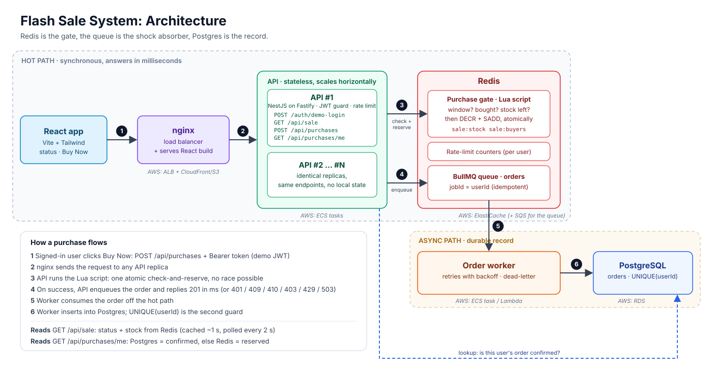

# Flash Sale System

A high-throughput flash sale for a single product with limited stock. Each user can buy at most one unit, and the system must never oversell, even under heavy concurrent load.

<!-- TODO: Quick start, running tests, stress test results -->

## API

| Method | Path | Purpose |
| --- | --- | --- |
| POST | `/api/auth/demo-login` | Demo sign-in. Body: `{ "userId": "username or email" }`. Returns a signed JWT (no password; see Authentication) |
| GET | `/api/sale` | Product (name, price, image) and sale status: `upcoming`, `active`, `ended` or `sold_out`, plus times, stock left and server time. Public |
| POST | `/api/purchases` | Attempt a purchase. Header `Authorization: Bearer <token>`, no body; the userId comes from the token |
| GET | `/api/purchases/me` | Check if the signed-in user secured an item: `reserved` (in Redis, queued) or `confirmed` (saved in Postgres) |
| GET | `/health` | Liveness of the API, Redis and Postgres |

Purchase results:

| Result | HTTP |
| --- | --- |
| `SUCCESS` | 201 |
| `ALREADY_PURCHASED` | 409 |
| `SOLD_OUT` | 410 |
| `NOT_STARTED` / `ENDED` | 403 |
| Invalid `userId` at sign-in | 400 |
| Missing, invalid or expired token | 401 |
| Rate limited | 429 |
| Redis unavailable (fail closed) | 503 |

`userId` is trimmed and lowercased at sign-in, so `Eli@X.com` and `eli@x.com` count as the same user.

## Design Choices and Trade-offs

### The core idea

**Redis is the gate, the queue is the shock absorber, Postgres is the record.**

Every purchase attempt runs as one atomic Lua script in Redis. The script checks the sale window, whether the user already bought, and remaining stock, then reserves a unit, all in a single step that no other request can interrupt. Winners are handed to a queue, and a worker saves them to Postgres. The database never sits on the hot path, so the traffic spike never reaches it.



### Tech stack

| Layer | Choice | Why | Trade-off |
| --- | --- | --- | --- |
| API | NestJS on the Fastify adapter | NestJS gives clear structure (modules, dependency injection, validated DTOs). Fastify replaces Express underneath for lower per-request overhead. | A little more boilerplate than plain Fastify; Express-only middleware cannot be used (none is needed here). |
| Concurrency control | Redis + Lua script | Redis runs one script at a time, so check-and-reserve is atomic without locks. Sub-millisecond, and shared by every API instance. | Redis becomes a critical dependency. |
| Queue | BullMQ (on Redis) | Takes the database write off the request path. Retries, backoff and dead-letter handling are built in. | Shares Redis with the gate, so one outage affects both. In the cloud this would be SQS. |
| Database | PostgreSQL via Prisma | Durable source of truth. A unique index on `userId` is a second guard against duplicate purchases. | Lags Redis by a few milliseconds (eventual consistency). |
| Frontend | React + Vite + TypeScript + Tailwind CSS | React is required. Vite keeps setup fast and builds to static files. Tailwind gives a clean UI quickly without writing custom CSS. | Tailwind classes make JSX more verbose. The UI is one page, so no need for a larger framework like Next.js. |
| Stress testing | k6 | Scripted scenarios, ramp-up, pass/fail thresholds and a readable summary. | Needs k6 installed, or run through Docker. |
| Local infra | Docker Compose | One command starts Redis, Postgres, API replicas, worker and frontend. | Local only, not a production deployment (by design, per the brief). |

### Why not the alternatives?

- **Row lock in Postgres (`SELECT ... FOR UPDATE`)**: every buyer would queue on one hot row, and the database becomes the bottleneck at a few thousand requests per second.
- **Distributed lock (e.g. Redlock)**: extra round trips and failure modes for something a single Lua script already makes atomic.
- **In-memory simulation instead of Redis**: each API instance would have its own memory, so it could not prove the rules hold across multiple instances.
- **Writing to Postgres inside the request**: simpler, but puts the slowest component on the hot path.

### Two guards, one rule

"One item per user" is enforced twice: by the Redis buyers set (fast, during the sale) and by the Postgres unique index (permanent). The queue job ID is the `userId`, so retries can never create a second order.

### Fail closed

If Redis is unavailable, purchase requests return `503` immediately. The system never falls back to a path that could oversell. Telling a user "try again" is better than selling stock that does not exist.

### Product and sale configuration

The brief describes one product with a predefined stock, so the product is **configuration, not data**:

```env
PRODUCT_NAME="[Product name]"
PRODUCT_PRICE="[Price]"
PRODUCT_IMAGE_URL="/images/product.svg"
SALE_STARTS_AT=2026-09-30T10:00:00Z
SALE_ENDS_AT=2026-09-30T10:30:00Z
SALE_STOCK=100
```

At startup the API validates these and seeds them into Redis (`sale:config`, `sale:stock`) only if they are not already set, so a restart never resets a running sale. `GET /api/sale` returns the product with the status, and the frontend renders it.

**Trade-off:** no product table, admin screens or product endpoints to build, secure and test, and reviewers can change the sale by editing `.env`. The cost is that changing the product needs a restart and there is only one. For many products: a `Product` table with a seed script, and Redis keys prefixed by product ID (`sale:{productId}:stock`). The Lua script logic stays the same. The price is display only; payments are out of scope.

### Security (baseline for a test app)

| Measure | What it protects against |
| --- | --- |
| DTO validation (`class-validator`), 1 KB body limit | Malformed or oversized input reaching Redis |
| Signed JWT (short expiry) carries the userId | Tampering with the request body to buy as someone else |
| Rate limits per user and per IP (in Redis) | One client spamming, or rotating fake userIds from one machine |
| `@fastify/helmet` security headers | Common browser attacks (clickjacking, MIME sniffing) |
| CORS restricted to the frontend origin | Other websites calling the API from a user's browser |
| Prisma parameterized queries | SQL injection |
| React output escaping | XSS |
| Redis and Postgres on Docker's internal network only | Direct access to data stores from outside |
| Secrets in `.env` (only `.env.example` committed) | Credentials leaking through the repo |
| Admin reset endpoint off by default and token-protected | Resetting a sale outside of testing |
| Generic error responses, no stack traces | Leaking internals |

### Authentication (demo login)

The brief only asks users to "enter a user identifier (e.g., a username or email)", so full accounts are out of scope. Instead there is a lightweight demo login that uses the production pattern without passwords:

1. The user enters a username or email once. `POST /api/auth/demo-login` validates it and returns a JWT signed with a server secret (short expiry, e.g. 30 minutes).
2. The frontend keeps the token in memory and sends it as `Authorization: Bearer <token>`.
3. A NestJS `AuthGuard` verifies the token and sets `req.user.id`. The purchase logic only ever reads that value, never the request body.

**Why:** the API trusts the token, not the body, so a request cannot be edited to buy as someone else. It costs little and keeps the focus on concurrency, load and testing.

**Known limitation:** there is no password or identity check, so one person can still sign in under several names and claim several units. Per-IP rate limiting slows this down but does not stop it.

**Production approach:** replace `/api/auth/demo-login` with real sign-in (OAuth, Amazon Cognito, or an emailed one-time code). Because identity is resolved only in the `AuthGuard`, nothing else changes. Bot protection (CAPTCHA or a virtual waiting room) would be added for real sales.

### Local infrastructure (Docker)

The brief allows cloud services to be mocked, so Docker Compose plays the role of AWS. Every container stands in for a managed service:

| Container | Stands in for (AWS) | Role |
| --- | --- | --- |
| `redis` | ElastiCache | Stock, buyers set, rate limits, and the BullMQ queue |
| `postgres` | RDS | Permanent order records |
| `api` × 2 | ECS tasks | NestJS on Fastify; two replicas prove the rules hold across instances |
| `worker` | ECS task reading from SQS | Moves orders from the queue into Postgres |
| `nginx` | Application Load Balancer + CloudFront/S3 | Load-balances the API and serves the React build |
| `k6` (on demand) | Load testing service | Runs the stress tests through nginx, like real traffic |

**Why Docker instead of simulating in memory:**

- Real Redis and Postgres mean the code and tests run against the same behavior as production, with no fake to maintain.
- Two API replicas share one Redis, which is the only honest way to prove "no overselling" across instances. An in-memory fake lives inside one process and cannot show that.
- One command (`docker compose up`) runs everything, so reviewers need nothing but Docker installed.

**Trade-offs:**

- Docker must be installed and running, and the first image pull takes a few minutes.
- Everything runs on one machine, so stress test numbers show correctness and relative performance, not real cloud capacity.
- The queue (SQS) is represented by BullMQ inside the Redis container rather than its own service. LocalStack could emulate real SQS, but it adds a heavy container for little gain.
- No high availability: one Redis, one Postgres. In production, Redis would run with replicas (Sentinel or cluster) and RDS with Multi-AZ.

**Development vs review:** during development only `redis` and `postgres` run in Docker, and the Node apps run with `npm run dev` for fast reloads. The full stack is for reviewers and stress tests.
